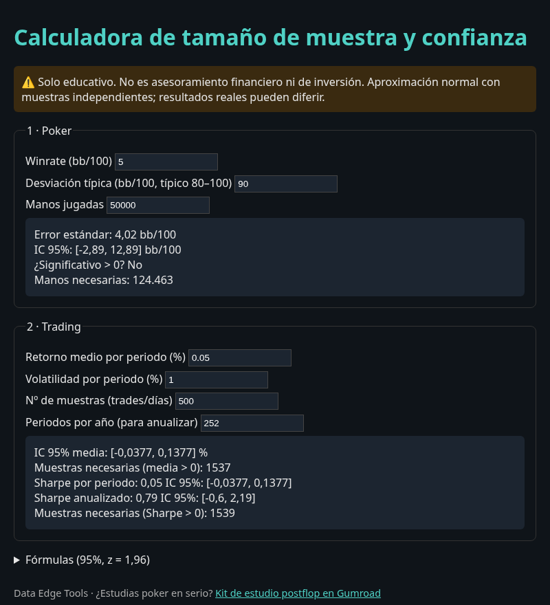

# 📊 Sample Size & Confidence Calculator · Calculadora de muestra y confianza

**¿De verdad ganas, o es varianza?** / **Are you actually winning, or is it variance?**

A free, zero-install calculator for poker players and traders: confidence intervals for your winrate / mean return / Sharpe ratio, and how many hands or trades you need before the result means anything.

👉 **Live demo / Pruébala online:** https://S4ntos23.github.io/sample-size-calculator/ *(GitHub Pages)*



[English](#english) · [Español](#español)

---

## English

### What it does
| Mode | Inputs | Outputs |
|---|---|---|
| Poker | winrate (bb/100), std dev (bb/100), hands | standard error, 95% CI, significant > 0?, hands needed |
| Trading | mean & volatility per period (%), n samples, periods/year | 95% CI of mean, Sharpe per period + annualized with CI, samples needed |

Example: a 5 bb/100 winner with SD 90 bb/100 needs **~124,000 hands** before the 95% CI excludes zero. After 50,000 hands the CI is still [-2.9, +12.9] bb/100.

### Usage
- **Browser:** open `index.html` (works offline) or use the GitHub Pages link.
- **CLI (Python 3, no dependencies):**
  ```bash
  python3 calc_muestra.py poker --wr 5 --manos 50000 --sd 90
  python3 calc_muestra.py trading --media 0.05 --vol 1 --n 500
  python3 test_calc.py
  ```

### Formulas (95%, z = 1.96)
- Poker: `SE = sd / sqrt(hands/100)`, `CI = wr ± z·SE`, `hands_needed = 100·(z·sd/wr)²`
- Mean return: `SE = σ/√n`, `CI = μ ± z·SE`, `n_needed = (z·σ/μ)²`
- Sharpe (Lo, 2002, iid): `S = μ/σ`, `SE(S) ≈ sqrt((1 + S²/2)/n)`, `n_needed = z²(1 + S²/2)/S²`, annualized `= S·√(periods/year)`

### Limitations
Normal approximation, independent samples. Real trading returns have fat tails and autocorrelation, and testing many strategies inflates false positives (multiple comparisons). Treat the outputs as a **lower bound** on the sample you need. Educational only, not financial advice.

---

## Español

### Qué hace
Te dice el intervalo de confianza de tu winrate (bb/100), de tu retorno medio o de tu Sharpe, y **cuántas manos o trades necesitas** para que el resultado signifique algo.

Ejemplo: con 5 bb/100 y desviación de 90 bb/100 necesitas **~124.000 manos** para que el IC 95% no incluya el cero. Con 50.000 manos el IC sigue siendo [-2,9, +12,9] bb/100.

### Uso
- **Navegador:** abre `index.html` (funciona sin internet) o usa el enlace de GitHub Pages.
- **Terminal:** `python3 calc_muestra.py poker --wr 5 --manos 50000` · `python3 calc_muestra.py trading --media 0.05 --vol 1 --n 500`

### Fórmulas
Las mismas de arriba (aproximación normal, z = 1,96). Sharpe según Lo (2002), *The Statistics of Sharpe Ratios*.

### Limitaciones
Supone muestras independientes y normalidad aproximada. Colas gruesas, autocorrelación y probar muchas estrategias hacen que necesites **más** muestra. Solo educativo. No es asesoramiento financiero.

---

## More tools · Más herramientas — Data Edge Tools
- [Postflop study kit (open-source solver templates)](https://santosphere7720.gumroad.com/l/jnnqpe) — $12
- [Free postflop mini-kit](https://santosphere7720.gumroad.com/l/qgkhh) — free / pay what you want
- [This calculator on Gumroad](https://santosphere7720.gumroad.com/l/gamihw) — free / pay what you want

## License
MIT © 2026 Data Edge Tools. See [LICENSE](LICENSE).
